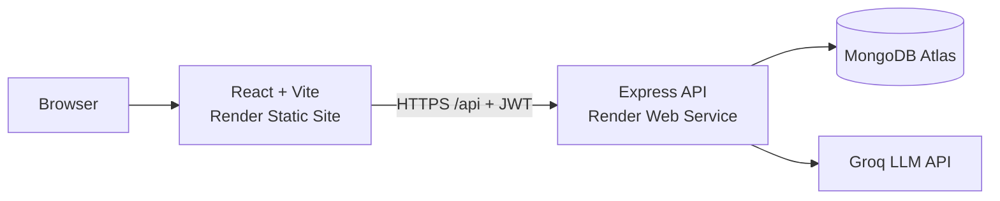

# AI Notes Summarizer

Turn long notes and PDFs into summaries, cheat sheets, roadmaps and diagrams, then chat with them. Built with the MERN stack and Groq.

**Live demo:** https://ai-notes-summarizer-1-4mei.onrender.com (free hosting: the first load may take about a minute)

## 1. Overview

**AI Notes Summarizer** is a full-stack MERN web application that turns long text or text-based PDFs into study-ready output. Paste your notes (or upload a file) and get a **summary**, a **cheat sheet**, a **learning roadmap** or a **flowchart diagram**, then keep the conversation going by asking questions about the note in a built-in chat.

Live demo: https://ai-notes-summarizer-1-4mei.onrender.com

> **Cold start:** The backend runs on a free Render instance that sleeps after 15 minutes of inactivity. The first request after a pause can take about a minute while it wakes up.

The AI layer uses the Groq API (OpenAI-compatible chat completions). The app discovers the models available to the account at runtime and picks the best one, so it keeps working even when a model is removed.

## 2. Features

### Authentication and security

- Signup and login with **bcrypt**-hashed passwords.
- **JWT access token** (15 minutes) plus **refresh token** (30 days); the frontend refreshes silently on a 401 using a request queue.
- Protected routes on both the API and the React app.
- Rate limiting, XSS cleaning, NoSQL-injection sanitizing and a CORS allow-list (see Security).

### AI output modes

| Mode | What you get |
|---|---|
| Summary | Short, Medium or Detailed length, with the word reduction shown. |
| Cheat Sheet | Compact revision sheet in Markdown (tables supported). Can be downloaded as an image. |
| Roadmap | Step-by-step learning path for the topic. |
| Diagram | Flowchart generated as Mermaid code and rendered in the browser. Invalid code is checked before rendering. |

### Chat with your note

- Ask follow-up questions about any saved note; answers use the note's text and generated output as context.
- The assistant replies in the language of your question and remembers the last 6 messages.
- Chat history lives in the open page only; it is not stored in the database.

### Note management

- Pin, rename and tag notes (General, Work, Study, Personal) and filter the list.
- Regenerate the output of a note in a different mode.
- Share a note using the device's share options.
- Duplicate titles are blocked (case-insensitive) among active notes.
- Pagination: 10 notes per page with a Load More button.
- **Trash:** notes are soft-deleted, can be restored or deleted permanently, and are purged automatically after **30 days**.
- A "Words Saved" statistic computed from summary notes.

### Input and interface

- Paste text, upload a `.txt` file or upload a **text-based PDF** (text is extracted in the browser with pdf.js).
- **Voice input** through the Web Speech API (Chrome recommended).
- Light and dark themes, animated UI (framer-motion), toast notifications and skeleton loaders.

## 3. Tech Stack

| Layer | Technology |
|---|---|
| Frontend | React 19, Vite, react-router-dom 7, axios, framer-motion, react-hot-toast, lucide-react, react-markdown + remark-gfm, mermaid, html2canvas, pdfjs-dist |
| Backend | Node.js, Express 5, Mongoose 9, jsonwebtoken, bcryptjs, express-rate-limit, xss, cors, dotenv |
| Database | MongoDB Atlas (free M0 cluster) |
| AI | Groq API, OpenAI-compatible chat completions (gpt-oss and llama model families, chosen automatically) |
| Testing | Jest and supertest (7 tests) |
| Hosting | Render Static Site (frontend), Render Web Service (backend) |

## 4. Architecture



The browser loads the React single-page app from the static site. All data operations go to the Express API over HTTPS with a Bearer token. The API reads and writes MongoDB Atlas and calls Groq to generate content. API keys exist only on the server.

### Request flow: creating a note

1. The user submits a title, text, tag and output type from the Dashboard.
2. axios sends `POST /api/notes` with the access token. If it has expired, the interceptor calls `/api/auth/refresh`, then retries.
3. The server checks the token, sanitizes the body and rejects duplicate titles.
4. `generateContent` picks an available Groq model and builds the prompt for the chosen mode (input is capped at 10,000 characters).
5. The result is saved in the `Note` document and returned to the browser, which renders Markdown or Mermaid.

## 5. Project Structure

```
ai-notes-summarizer/
|-- backend/
|   |-- config/db.js              MongoDB connection
|   |-- controllers/              authController.js, noteController.js
|   |-- middleware/authMiddleware.js
|   |-- models/                   User.js, Note.js
|   |-- routes/                   authRoutes.js, noteRoutes.js
|   |-- tests/                    auth.test.js, summarize.test.js
|   |-- utils/                    generateContent.js, summarize.js, chatWithNote.js, autoPurge.js
|   |-- .env.example
|   `-- server.js
|-- frontend/
|   |-- public/
|   |-- src/
|   |   |-- api/axios.js          axios instance + token refresh interceptor
|   |   |-- components/           NoteCard.jsx, SkeletonCard.jsx
|   |   |-- context/              AuthContext.jsx, ThemeContext.jsx
|   |   |-- pages/                Dashboard, Login, Signup, Trash
|   |   `-- utils/pdfReader.js
|   |-- .env.example
|   `-- vite.config.js
|-- LICENSE
`-- README.md
```

## 6. Getting Started

### Prerequisites

- Node.js 20 or newer and npm
- A free MongoDB Atlas cluster and its connection string
- A free Groq API key

### Clone and install

```bash
git clone https://github.com/01-bhoomi/ai-notes-summarizer.git
cd ai-notes-summarizer

cd backend && npm install
cd ../frontend && npm install
```

### Environment variables

Copy each `.env.example` to `.env` and fill in your own values. Never commit real secrets.

| File | Variable | Purpose |
|---|---|---|
| backend/.env | `MONGO_URI` | MongoDB Atlas connection string |
| backend/.env | `PORT` | API port (default 5000) |
| backend/.env | `JWT_SECRET` | Signs 15-minute access tokens |
| backend/.env | `JWT_REFRESH_SECRET` | Signs 30-day refresh tokens (use a different value) |
| backend/.env | `GROQ_API_KEY` | Groq API key |
| backend/.env | `CLIENT_URL` | Allowed frontend origin(s), comma separated |
| frontend/.env | `VITE_API_URL` | Backend base URL, for example http://localhost:5000/api |

### Run locally

```bash
# terminal 1
cd backend && npm run dev

# terminal 2
cd frontend && npm run dev
```

Open http://localhost:5173. Run the backend tests with `npm test` inside `backend/`.

> **Tip:** On macOS, port 5000 may be used by AirPlay Receiver. If the API cannot start, set `PORT=5001` in `backend/.env` and update `VITE_API_URL` to match.

## 7. API Reference

Base path: `/api`. Note routes require the header `Authorization: Bearer <accessToken>`.

| Method | Endpoint | Description |
|---|---|---|
| POST | `/auth/signup` | Create an account (rate limited) |
| POST | `/auth/login` | Log in, returns access and refresh tokens (rate limited) |
| POST | `/auth/refresh` | Exchange a refresh token for a new access token |
| POST | `/auth/logout` | Invalidate the stored refresh token |
| POST | `/notes` | Create a note and generate its output |
| GET | `/notes?page&limit` | List active notes, paginated |
| GET | `/notes/trash` | List notes in the trash |
| PATCH | `/notes/:id` | Update title, tag or pinned state |
| DELETE | `/notes/:id` | Soft delete (move to trash) |
| PATCH | `/notes/:id/restore` | Restore a note from the trash |
| DELETE | `/notes/:id/permanent` | Delete a note permanently |
| POST | `/notes/:id/ask` | Ask a question about the note (chat) |
| POST | `/notes/:id/regenerate` | Regenerate output in another mode |

## 8. Security

| Measure | Detail |
|---|---|
| Password storage | bcrypt hashes; plain passwords are never stored. |
| Token model | Short-lived access token plus refresh token kept on the user record; logout clears it. |
| Rate limiting | 100 requests per 15 minutes per IP on `/api`; 10 per 15 minutes on signup and login. |
| Input cleaning | `xss` package plus a custom middleware that removes keys starting with `$` or containing `.` (NoSQL injection). |
| CORS | Allow-list read from `CLIENT_URL`. |
| Secrets | Kept in `.env`, excluded by `.gitignore`; only `.env.example` files are committed. |
| Proxy | `trust proxy` is enabled so rate limiting sees real client IPs behind Render. |

> **Design note:** Tokens are stored in the browser's localStorage. This is simple and common for learning projects; an httpOnly cookie setup would be stronger against XSS and is listed under Future Improvements.

## 9. Deployment

### Database (MongoDB Atlas)

- Create a free M0 cluster and a database user.
- Under Network Access allow `0.0.0.0/0`, because Render's outgoing IPs change.
- Copy the connection string into `MONGO_URI`. Atlas free clusters pause after 30 days of inactivity; your data is kept and the cluster can be resumed.

### Backend (Render Web Service)

- Root directory `backend`, build command `npm install`, start command `node server.js`.
- Add the backend environment variables in the Render dashboard (never in the repository). Set `CLIENT_URL` to the frontend URL.

### Frontend (Render Static Site)

- Root directory `frontend`, build command `npm install && npm run build`, publish directory `dist`.
- Set `VITE_API_URL` to the deployed backend URL ending in `/api`. Vite embeds this value at build time, so redeploy after changing it.
- Add a rewrite rule `/*` to `/index.html` so direct visits to routes such as `/login` work.

> **Note:** For a public repository, Render may need a manual deploy after each push.

## 10. Usage Guide

1. Open the app and **sign up** with name, email and password, then log in.
2. On the Dashboard enter a **title**, for example "Internet Basics".
3. Paste your text, upload a `.txt` or text-based `.pdf`, or press the mic and speak.
4. Choose a **tag** and a mode: Summary, Cheat Sheet, Roadmap or Diagram. For summaries, pick Short, Medium or Detailed.
5. Click create. The note appears at the top with the generated output.
6. Use **Ask** on the card to chat about the note, or regenerate it in another mode.
7. Pin, rename, share or delete notes from the card menu. Deleted notes stay in Trash for 30 days.

**Example.** Pasting about 400 words on how the Internet works and choosing Summary / Short returns a short paragraph with the percentage of words saved. Choosing Diagram instead returns a flowchart of the same topic.

## 11. Limitations

| Area | Limitation |
|---|---|
| Input size | Recommended up to about 10,000 characters; longer text is truncated before it is sent to the model. The server's default JSON body limit is about 100 KB. |
| Files | `.txt` and text-based PDFs only. Scanned PDFs and image uploads are not supported (no OCR). |
| Language | Best in English. Hindi and Hinglish output is of lower quality because free LLMs are English-first and no dedicated translation service is used. |
| Voice input | Reliable in Chrome only; one language at a time (English, India). |
| Chat memory | Conversation is kept only while the page is open. |
| AI quota | The Groq free tier has per-minute and per-day request and token limits, shared by all users. |
| Hosting | Free Render instances sleep after 15 minutes idle and share 750 instance hours per month. |

## 12. Future Improvements

- **Image and scanned-PDF upload** using OCR or a vision-capable model.
- **Long document support** by splitting text into chunks and summarizing in stages (map-reduce).
- Persist chat history in the database.
- Move tokens to httpOnly cookies and add email verification and password reset.
- Multi-language voice input and a dedicated translation step.
- Download buttons for Roadmap and Diagram outputs, and CI with automatic deploys.

## 13. License and Author

Copyright (c) 2026 Bhoomi Singh. All rights reserved. This source code is provided for viewing and evaluation only. No permission is granted to copy, modify, distribute, sublicense or use this software without prior written permission. See the `LICENSE` file.

Author: **Bhoomi Singh**, GitHub: https://github.com/01-bhoomi
