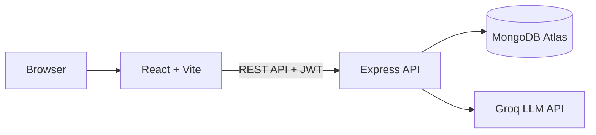

# AI Notes Summarizer

A full-stack MERN web app that turns long notes and PDFs into summaries, cheat sheets, learning roadmaps and flowchart diagrams, and lets you chat with your notes to understand them faster. AI is powered by the Groq API.

**Live demo:** https://ai-notes-summarizer-1-4mei.onrender.com

## Features

- **Four output modes:** Summary (short, medium, detailed), Cheat Sheet, Roadmap and Diagram (Mermaid flowchart)
- **Chat with your note:** ask follow-up questions; replies come in the language you ask in
- **Input options:** paste text, upload `.txt` or text-based PDF files, or dictate with voice input
- **Note management:** pin, rename, tag (General, Work, Study, Personal), filter, regenerate and share
- **Trash:** soft delete with restore; notes are purged automatically after 30 days
- **Download cheat sheet** as an image
- **Authentication:** JWT access and refresh tokens with silent refresh, bcrypt password hashing
- **Light and dark theme**, responsive UI

## Tech Stack

| Layer | Technology |
|---|---|
| Frontend | React 19, Vite, React Router, Axios, Framer Motion, Mermaid, react-markdown |
| Backend | Node.js, Express 5, Mongoose, JWT, bcrypt |
| Database | MongoDB Atlas |
| AI | Groq API (OpenAI-compatible chat completions) |
| Testing | Jest, Supertest |
| Hosting | Render |

## Architecture



## Getting Started

**Prerequisites:** Node.js 20+, a MongoDB Atlas connection string and a Groq API key.

```bash
git clone https://github.com/01-bhoomi/ai-notes-summarizer.git
cd ai-notes-summarizer

# backend
cd backend
npm install
cp .env.example .env     # fill in your values
npm run dev

# frontend (new terminal)
cd frontend
npm install
cp .env.example .env
npm run dev
```

Open http://localhost:5173.

### Environment variables

| File | Variable | Description |
|---|---|---|
| `backend/.env` | `MONGO_URI` | MongoDB connection string |
| `backend/.env` | `PORT` | API port (default 5000) |
| `backend/.env` | `JWT_SECRET` | Access token secret |
| `backend/.env` | `JWT_REFRESH_SECRET` | Refresh token secret |
| `backend/.env` | `GROQ_API_KEY` | Groq API key |
| `backend/.env` | `CLIENT_URL` | Allowed frontend origin |
| `frontend/.env` | `VITE_API_URL` | Backend API URL, e.g. `http://localhost:5000/api` |

Run tests: `cd backend && npm test`

## API Overview

| Method | Endpoint | Description |
|---|---|---|
| POST | `/api/auth/signup`, `/login`, `/refresh`, `/logout` | Authentication |
| POST | `/api/notes` | Create a note and generate output |
| GET | `/api/notes` | List notes (paginated) |
| PATCH | `/api/notes/:id` | Rename, tag or pin |
| DELETE | `/api/notes/:id` | Move to trash |
| PATCH | `/api/notes/:id/restore` | Restore from trash |
| DELETE | `/api/notes/:id/permanent` | Delete permanently |
| POST | `/api/notes/:id/ask` | Chat with a note |
| POST | `/api/notes/:id/regenerate` | Regenerate output |

All note routes require `Authorization: Bearer <token>`.

## Security

- Passwords hashed with bcrypt; short-lived access tokens with refresh tokens
- Rate limiting, XSS sanitizing and NoSQL-injection protection
- CORS allow-list and secrets kept in environment variables

## Project Structure

```
backend/    Express API (routes, controllers, models, middleware, utils, tests)
frontend/   React app (pages, components, context, api)
```

## Future Improvements

- Image and scanned-PDF upload (OCR)
- Long-document support through chunked summarization
- Saved chat history

## License

Copyright (c) 2026 Bhoomi Singh. All rights reserved. This code is shared for viewing and evaluation only; using, copying or distributing it requires prior written permission. See [LICENSE](LICENSE).

## Author

**Bhoomi Singh** - [GitHub](https://github.com/01-bhoomi)
